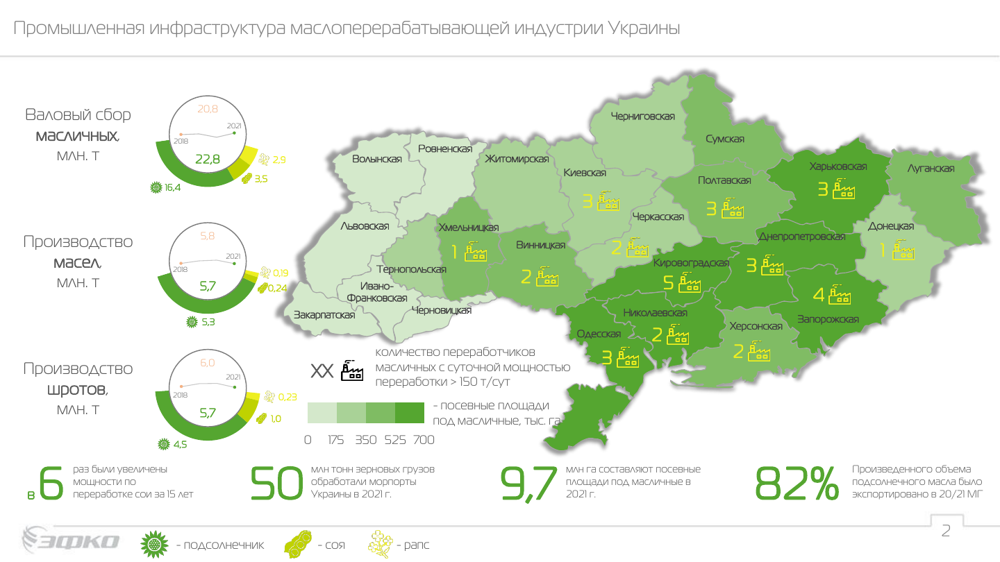

# Market Research Portfolio - аналитические материалы анализа различных направлений Агробизнеса

Автор: **Константин Сторожук / [MrKostas](https://github.com/MrKostas)** - анализ рынков, сценарные расчёты и управленческие презентации

Подборка рабочих материалов, в которых разнородные сведения о сырье, производстве, конкурентах и логистике сведены в аналитический рассказ для руководителя. Основной стек: **MS Excel - расчёты; MS PowerPoint - визуальная подача**.

*Настоящий слайд из исследования 16.12.2022: ресурс масличных, производство продуктов и география переработки. [Перейти к кейсу](cases/03-ukraine-oilseed-market/README.md).*

## С чего начать работодателю

- **Сценарное мышление и экономика переработки:** [закупочные зоны масличных](cases/04-oilseed-procurement-scenarios/README.md) - как изменение мощностей конкурентов влияет на распределение сырья.
- **Исследование нового рынка:** [бактериальные удобрения](cases/01-biofertilizer-market/README.md) - от технологии продукта к сегментации рынка и профилям производителей.
- **Сравнение стран:** [пальмовое масло Африки](cases/05-africa-palm-oil-market/README.md) - ресурс, потребление, инфраструктура и условные сценарии до 2030 года.
- **Структура регулярной отчётности:** [макет дайджеста](cases/06-oilseed-market-digest-template/README.md) - повторяемые аналитические страницы и навигация.

## Навигация по работам

| Кейс | Дата / период материала | Рынки и задача | Что можно оценить |
|---|---|---|---|
| [Бактериальные удобрения](cases/01-biofertilizer-market/README.md) | 22.12.2021 | Мировой рынок инокулянтов, Россия, прогноз до 2026 года | Сегментация, анализ драйверов, профили компаний |
| [Промышленная инфраструктура Украины](cases/02-ukraine-industry-infrastructure/README.md) | 10.06.2022 | Масличные, хранение, переработка и портовые мощности | Географическая аналитика и сведение данных |
| [Сырьевая база и экспорт Украины](cases/03-ukraine-oilseed-market/README.md) | 16.12.2022 | Подсолнечник, соя, рапс, масла и шроты | Региональные профили, балансы и экспортная структура |
| [Сценарии закупки масличных](cases/04-oilseed-procurement-scenarios/README.md) | 14.01.2023 | Рязанская область и конкурирующие переработчики; сезоны 2022/23–2026/27 | Сценарное сравнение, ценовые базисы, экономика переработки |
| [Пальмовое масло Африки](cases/05-africa-palm-oil-market/README.md) | 14.02.2023 | Пять стран, производство и спрос, варианты размещения | Страновое сопоставление и условные прогнозы |
| [Макет отраслевого дайджеста](cases/06-oilseed-market-digest-template/README.md) | На обложке - февраль 2024 | Мировая и российская масложировая отрасль | Информационная архитектура и дизайн; показатели условные |
| [Структура выпуска мыла](cases/07-soap-production-mix/README.md) | Отчёт за 2023 год | Категории и SKU одной производственной площадки | Компактная визуализация производственного портфеля |

**7 материалов - 154 страницы - 13 превью реальных слайдов.** В каждом каталоге - описание задачи и результатов, PDF целиком и изображения выбранных страниц. Для чтения достаточно просмотрщика PDF; установка Excel или PowerPoint не требуется.

## Профессиональный контекст и вклад

Подборка демонстрирует направление работы специалиста по анализу информации: изучение рынков, расчёт показателей и сценариев, подготовка материалов для руководства. Заявленный период этой должности - **июль 2020 - сентябрь 2022**. В предоставленной папке также есть более поздние исследования и макеты **2022–2024 годов**; они включены с собственными датами и не приписаны указанному периоду должности.

Стек расчётов и оформления указан по сведениям владельца. Доступные PDF подтверждают содержание исследований, таблицы результатов и визуальную подачу. Они не позволяют проверить формулы и организацию Excel-моделей: файлы `.xlsx` и `.pptx` в исходном комплекте отсутствуют.

В исследованиях удобрений и инфраструктуры Украины Сторожук К. Р. указан ответственным на титуле. Материалы по рязанскому заводу и Африке подготовлены несколькими исполнителями, перечисленными в описаниях; исключительное авторство всей командной работы не заявляется. Дайджест и слайд о мыле представлены владельцем как примеры своих работ, без указания исполнителя на странице.

## Какие навыки показывают материалы

| Навык | Пример проявления |
|---|---|
| Исследование рынков | География спроса, размер и сегменты рынка инокулянтов |
| Анализ отраслевой цепочки | Сырьё → хранение → переработка → экспорт |
| Балансовый подход | Ресурс и использование сырья, масел и шротов |
| Конкурентный анализ | Переработчики, закупочные зоны и профили производителей |
| Сценарное сравнение | Разные составы мощностей и распределения сырья |
| Анализ экономики переработки | Выходы продуктов, ценовые базисы, логистика и затраты |
| Визуализация и коммуникация | Карты, сравнительные таблицы, инфографика и единые страновые/региональные карточки |
| Проектирование отчётности | Макет регулярного дайджеста с навигацией и типовыми страницами |

## Как читать результаты

Все показатели приведены в историческом контексте. Прогнозные значения обозначают ожидания на дату материала, а не подтверждённые результаты будущих периодов. Сценарные расчёты не представлены как обученные ML-модели. Выполнение рекомендаций, размер финансового эффекта и точность прогнозов в этом комплекте не подтверждаются.

README подготовлены по содержанию PDF с указанием страниц. Замеченные расхождения, неодинаковые периоды и единицы измерения перечислены в соответствующих кейсах. Выводы макета дайджеста не подменяются рыночными: его числа и подписи служат демонстрацией компоновки.

В копиях PDF удалены унаследованные служебные метаданные и изменены имена файлов. Страницы, исторические показатели, названия компаний, фирменные элементы и указанные соисполнители сохранены. Превью - растровые изображения настоящих страниц, без перерисовки данных.

## Назначение портфолио

Материалы собраны для демонстрации профессионального опыта потенциальному работодателю. Названия организаций и брендов приведены как часть исторических работ; репозиторий не является официальной публикацией этих организаций. Лицензия на свободное использование материалов не назначена.

## English summary

A portfolio of market research and management presentations by Konstantin Storozhuk. Seven PDF case studies cover biofertilizers, oilseed supply and processing, export infrastructure, procurement scenarios, African palm oil markets, report design and manufacturing product mix. Calculations were prepared in Microsoft Excel and presentation visuals in Microsoft PowerPoint, as reported by the portfolio owner. Each case includes a Russian README, the full PDF and real slide previews. Historical forecasts, team contributions and source limitations are identified. Editable Excel and PowerPoint source files are not included.
