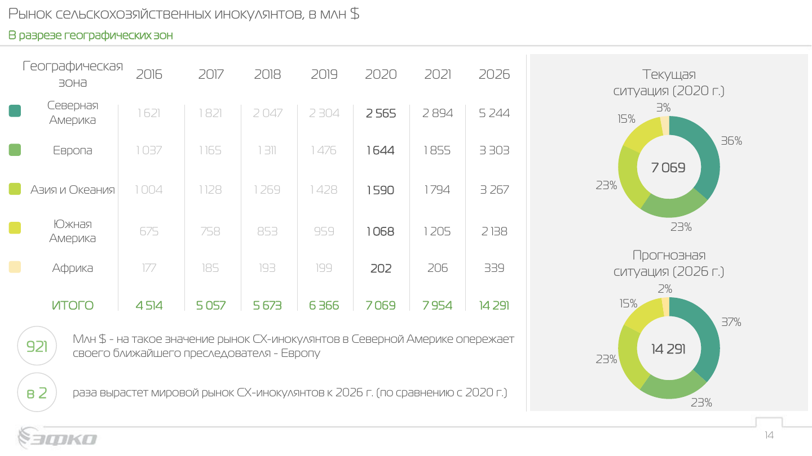
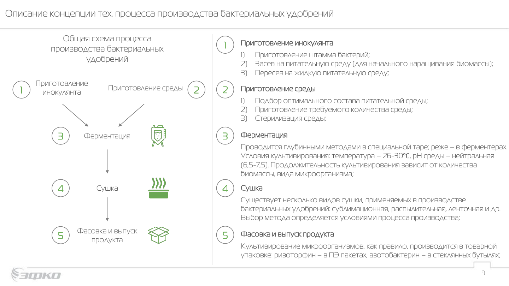

# Мировой рынок бактериальных удобрений

[← Все кейсы](../../README.md) · [Открыть PDF](presentation.pdf) · [Показанный слайд](presentation.pdf#page=14)

**Формат:** Обзор рынка и прогнозные оценки

**Дата / период:** 22.12.2021

**Объём:** 33 стр.

*Географическая структура и прогноз рынка, стр. 14.*

## Задача и охват

Систематизировать новый для бизнеса рынок: объяснить назначение бактериальных удобрений, оценить его размер и перспективы, сопоставить географические сегменты и основных производителей.

Изучены сельскохозяйственные инокулянты: бактериальные и грибковые продукты, виды используемых бактерий, культуры и методы внесения. География: Северная и Южная Америка, Европа, Азия и Океания, Африка; отдельно представлены Россия и группа стран, названная в исходнике «СНГ». Динамика охватывает 2016–2021 годы и прогнозные оценки на 2026 год.

## Что сделано

- Связаны предпосылки спроса — состояние почв, органическое земледелие и агротехнологии — с назначением продукта (стр. 2–10).
- Подготовлены классификация инокулянтов, паспорта четырёх видов бактериальных удобрений и схема производства: подготовка культуры и среды → ферментация → сушка → фасовка.
- Сопоставлены размеры и структура рынков по видам бактерий, регионам, странам, культурам и способам внесения (стр. 11–23).
- Собраны девять профилей производителей: BASF, Novozymes, T. Stanes, Verdesian, New Edge Microbials, Rizobacter, Premier Tech, Advanced Biological Marketing и Lallemand (стр. 25–33).

## Выводы и прогнозные оценки материала

| Показатель | База 2020 года | Прогноз на 2026 год | Где смотреть |
|---|---:|---:|---|
| Все сельскохозяйственные инокулянты | 7 069 млн $ | 14 292 млн $ | стр. 11, 13 |
| Бактериальные инокулянты | 4 335 млн $ | 8 892 млн $ | стр. 13 |
| Северная Америка | 2 565 млн $ | 5 244 млн $ | стр. 14–15 |
| Россия | 78 млн $ | 156 млн $ | стр. 23 |

В исследовании Северная Америка выделена как крупнейший региональный рынок; для России и мирового рынка показан потенциал примерно двукратного роста. Конкурентный обзор описывает расширение продуктовых линеек, R&D и сделки M&A как направления развития игроков (стр. 24–33).

Это прогнозы и оценки, приведённые в презентации 2021 года. Проверка их исполнения и обновление рынка на текущую дату в портфолио не проводились. По одному PDF нельзя установить, какие прогнозные ряды рассчитаны автором, а какие перенесены из внешних исследований.

## Личный вклад и визуальная подача

На титульной странице ответственным указан Сторожук К. Р. Кейс показывает сочетание предметного исследования с количественной сегментацией рынка и переводом технического материала на язык управленческой презентации.

Использованы сопоставимые таблицы, кольцевые диаграммы структуры, столбцы динамики, технологическая схема и единый формат паспортов компаний. Эти решения позволяют последовательно перейти от объяснения продукта к оценке спроса и конкурентной среды.

## Маршрут просмотра

| Страницы PDF | Содержание |
|---|---|
| 2–10 | Предпосылки, продукт, технология и драйверы |
| 11–21 | Размер рынка и географическая/продуктовая сегментация |
| 23–24 | Россия и конкурентная среда |
| 25–33 | Профили производителей |

## Ограничения исходного материала

Размер всего рынка инокулянтов шире рынка только бактериальных удобрений — эти показатели нельзя подменять друг другом. В сводных таблицах встречаются небольшие расхождения итогов, например 14 292 и 14 291 млн $ на 2026 год. Слайд 22 — разделитель с единицами «тыс. т», за которым следует денежная оценка России; полноценный натуральный баланс из этого раздела не следует. На нескольких последних профилях сохранились повторённые шаблонные подписи компаний. Исходный PDF сохранён по содержанию; эти элементы не исправлялись задним числом.

## Ещё один слайд

*Схема производства бактериальных удобрений, стр. 9.*

## Инструменты и состав

**MS Excel** — основной инструмент расчётов; **MS PowerPoint** — подготовка визуальной презентации, по сведениям владельца портфолио. В этом комплекте доступны PDF и превью; рабочие Excel-книги, формулы и редактируемые PowerPoint-файлы не приложены.

## Происхождение материала

Исходный файл: `Анализ мирового рынка бактериальных удобрений_Сторожук.pdf`. Для портфолио изменены имя файла и служебные метаданные PDF; содержание страниц, фирменное оформление и указанные исполнители сохранены. Все числа и выводы выше относятся к этому историческому материалу.
