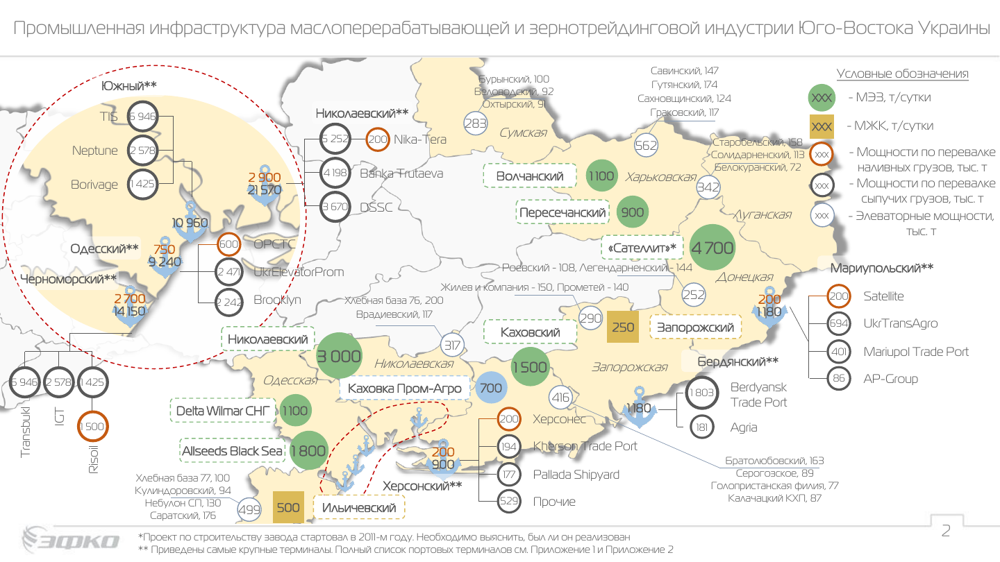
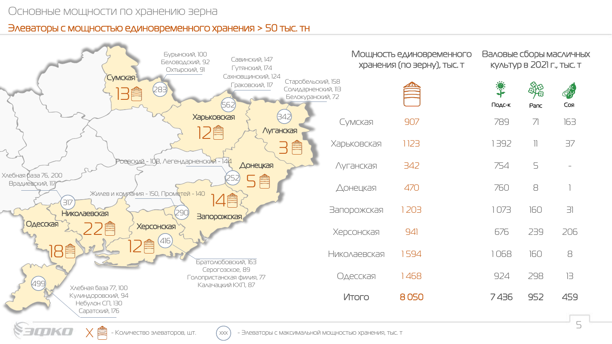

# Переработка, хранение и портовая инфраструктура Украины

[← Все кейсы](../../README.md) · [Открыть PDF](presentation.pdf) · [Показанный слайд](presentation.pdf#page=2)

**Формат:** Отраслевой и географический обзор

**Дата / период:** 10.06.2022

**Объём:** 15 стр.

*Сводная карта переработки, хранения и перевалки, стр. 2.*

## Задача и охват

Собрать обзор производственных, заготовительных и портовых мощностей южной, юго-восточной и восточной частей Украины. Представить цепочку «сырьевая база → хранение → переработка → экспортная инфраструктура» в одном материале.

Изучены подсолнечник, соя, рапс, растительные масла и зернотрейдинговая инфраструктура. Региональная сводка включает Сумскую, Харьковскую, Луганскую, Донецкую, Запорожскую, Херсонскую, Николаевскую и Одесскую области. Для сырьевой базы приведены валовые сборы 2021 года.

## Что сделано

- Сведены в карту перерабатывающие предприятия, элеваторы, порты и крупнейшие терминалы (стр. 2).
- Выделены мощности МЭЗ по культурам и мощности масложировых комбинатов; суточная переработка отделена от годовой перевалки и единовременного хранения (стр. 3–5).
- Сопоставлены региональные зернохранилища и объёмы сборов трёх масличных культур.
- Подготовлены приложения с перечнями наливных и зерновых терминалов и элеваторов (стр. 7–15). Для элеваторов на слайдах заявлен порог отбора более 50 тыс. т; в приложениях также встречаются значения ровно 50 тыс. т.

## Результаты материала

На стр. 5 в региональной сводке указаны **8 050 тыс. т** единовременного хранения по выбранным областям. Валовые сборы 2021 года в том же охвате: **7 436 тыс. т подсолнечника**, **952 тыс. т рапса** и **459 тыс. т сои**.

На стр. 4 сводка основных портов даёт **6 750 тыс. т/год** по маслу и **59 980 тыс. т/год** по зерну. В этой таблице крупнейший зерновой узел - Николаевский порт (**21 570 тыс. т/год**), далее Черноморский (**14 150**) и Южный (**10 960**).

Материал позволяет увидеть пространственное сочетание сырьевой базы, переработки и экспортных узлов. Он не содержит самостоятельной оптимизационной модели логистики или расчёта экономического эффекта.

## Личный вклад и визуальная подача

На титульной странице ответственным указан Сторожук К. Р. Пример показывает сбор отраслевой информации, её сведение к единой системе показателей и подготовку многослойной карты для руководителя.

Цвет и условные обозначения различают переработку, хранение и два вида грузов; таблицы рядом с картами дают возможность перейти от общего расположения к числам. Приложения сохраняют детализацию, не перегружая основной рассказ перечнями предприятий.

## Маршрут просмотра

| Страницы PDF | Содержание |
|---|---|
| 2 | Общая инфраструктурная карта |
| 3 | Предприятия и культуры в переработке |
| 4–5 | Порты, хранение и сырьевая база |
| 7–9 | Терминалы по видам грузов |
| 10–15 | Элеваторная инфраструктура и перечни |

## Ограничения исходного материала

Это историческая инвентаризация, представленная 10 июня 2022 года. Наличие объекта на карте не подтверждает его фактическую доступность или работу на дату подготовки и тем более сейчас. На стр. 2–3 отдельно отмечено, что реализация одного проекта требует уточнения.

Сводка стр. 4 и приложения имеют разные итоги: 6 750 против 10 700 тыс. т/год для наливных грузов, 59 980 против 60 087 тыс. т/год для сыпучих. Полнота охвата и округления требуют сверки по первичным данным; складывать эти таблицы нельзя. Емкость хранения и объём урожая характеризуют разные процессы: их сопоставление само по себе не доказывает дефицит хранения.

## Ещё один слайд

*Сопоставление хранения и сырьевой базы по областям, стр. 5.*

## Инструменты и состав

**MS Excel** - основной инструмент расчётов; **MS PowerPoint** - подготовка визуальной презентации, по сведениям владельца портфолио. В этом комплекте доступны PDF и превью; рабочие Excel-книги, формулы и редактируемые PowerPoint-файлы не приложены.

## Происхождение материала

Исходный файл: `Презентация 10.06.2022.pdf`. Для портфолио изменены имя файла и служебные метаданные PDF; содержание страниц, фирменное оформление и указанные исполнители сохранены. Все числа и выводы выше относятся к этому историческому материалу.
