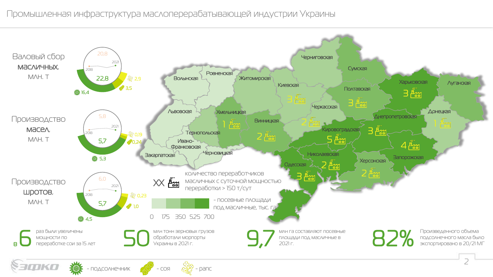
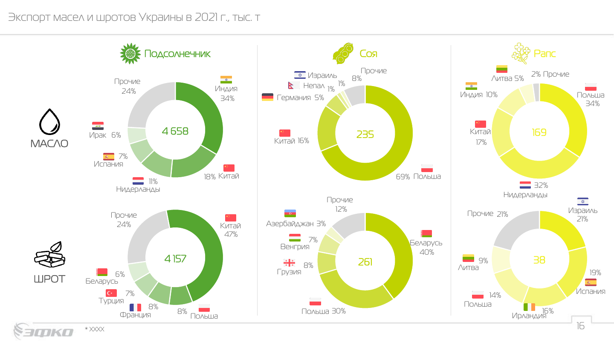

# Сырьевая база и экспорт продуктов переработки масличных Украины

[← Все кейсы](../../README.md) · [Открыть PDF](presentation.pdf) · [Показанный слайд](presentation.pdf#page=2)

**Формат:** Отраслевые балансы и региональные профили

**Дата / период:** 16.12.2022

**Объём:** 35 стр.

*Сводка сырьевой базы, переработки и размещения предприятий, стр. 2.*

## Задача и охват

Связать ресурс масличных культур с перерабатывающими и зернотрейдинговыми мощностями и экспортными потоками. Перейти от обзора расположения активов к сопоставимым региональным профилям и балансам сырья, масла и шрота.

Культуры: подсолнечник, соя и рапс. Страновая сводка дополнена профилями 13 областей: Донецкой, Запорожской, Херсонской, Николаевской, Одесской, Харьковской, Днепропетровской, Кировоградской, Полтавской, Черкасской, Киевской, Винницкой и Хмельницкой. Основная база экспорта — 2021 год; в региональных сравнениях встречаются 2017, 2018 и 2021 годы.

## Что сделано

- Подготовлены сводная карта посевных площадей и переработчиков, показатели валового сбора, выпуска масел и шротов (стр. 2).
- Разработан единый формат регионального профиля: краткая характеристика, сырьевая база, выпуск продукции, элеваторы, переработчики и водная логистика (стр. 3–15).
- Разложен экспорт масел и шротов по направлениям для каждой из трёх культур (стр. 16).
- Представлены ресурс и использование сырья и продуктов переработки через производство, импорт, экспорт и внутреннее потребление (стр. 17).
- Приложены таблицы терминалов и зернохранилищ с региональными итогами (стр. 19–35).

## Результаты материала

| Экспорт 2021 года | Подсолнечник | Соя | Рапс |
|---|---:|---:|---:|
| Масло, тыс. т | 4 658 | 235 | 169 |
| Шрот, тыс. т | 4 157 | 261 | 38 |

Источник чисел — стр. 16–17. На стр. 16 крупнейшие направления подсолнечного масла — Индия (**34%**) и Китай (**18%**); для подсолнечного шрота выделяется Китай (**47%**). Для соевого масла крупнейшее направление — Польша (**69%**). Это структура экспорта указанного года, а не текущая картина торговли.

Страновая сводка стр. 2 показывает около **9,7 млн га** под масличными в 2021 году и около **50 млн т** зерновых грузов, обработанных морпортами. Результат исследования — единая картина размещения ресурса, мощностей и экспортной зависимости продуктов с разной географией спроса.

## Личный вклад и визуальная подача

На титульной странице ответственным указан Сторожук К. Р. Кейс демонстрирует структурирование большого объёма разнородных сведений, сравнение регионов и построение отраслевых балансов.

Использованы карты с масштабируемыми обозначениями мощностей, повторяемые карточки областей, диаграммы экспортной структуры и парные столбцы ресурса и использования. Единая цветовая кодировка культур связывает разделы презентации.

## Маршрут просмотра

| Страницы PDF | Содержание |
|---|---|
| 2 | Страновой обзор |
| 3–15 | Региональные профили |
| 16–17 | Экспортная география и балансы |
| 19–22 | Портовые терминалы и обзор хранения |
| 23–35 | Перечни зернохранилищ |

## Ограничения исходного материала

Документ представлен в декабре 2022 года, но преимущественно описывает статистику до 2022 года. Он не подтверждает текущую работу объектов и доступность маршрутов. Для карт указан отбор переработчиков с мощностью более 150 т/сутки и зернохранилищ более 50 тыс. т; фактические списки включают и пограничные значения.

В исходнике сохранились неточности шаблонных заголовков и единиц площади («м²» вместо ожидаемых «км²»). По Винницкой области основной слайд 14 содержит итог хранения 1 123 тыс. т, тогда как приложение на стр. 34 — 2 213 тыс. т; поэтому общий итог хранения 20 493 тыс. т из приложения не используется здесь как проверенный показатель. Часть периодов региональных сравнений различается. Исправление первичных таблиц и пересчёт балансов по PDF не выполнялись.

## Ещё один слайд

*Направления экспорта масел и шротов за 2021 год, стр. 16.*

## Инструменты и состав

**MS Excel** — основной инструмент расчётов; **MS PowerPoint** — подготовка визуальной презентации, по сведениям владельца портфолио. В этом комплекте доступны PDF и превью; рабочие Excel-книги, формулы и редактируемые PowerPoint-файлы не приложены.

## Происхождение материала

Исходный файл: `Презентация_16.12.2022.pdf`. Для портфолио изменены имя файла и служебные метаданные PDF; содержание страниц, фирменное оформление и указанные исполнители сохранены. Все числа и выводы выше относятся к этому историческому материалу.
