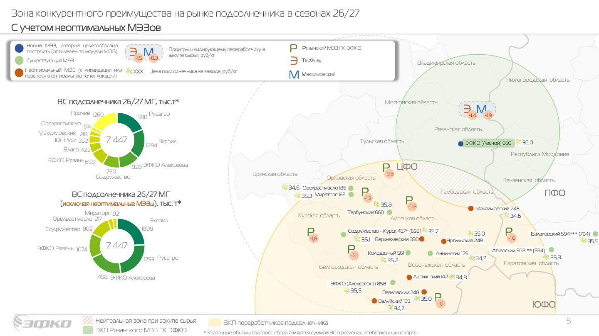
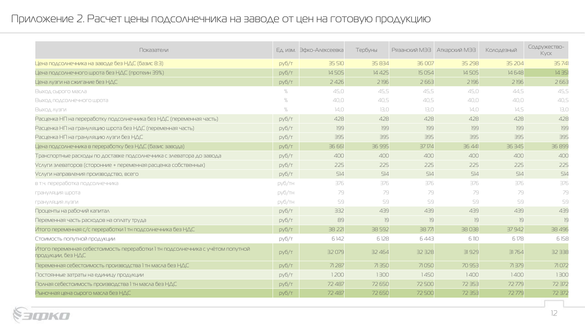

# Сценарии закупки масличных для завода в Рязанской области

[← Все кейсы](../../README.md) · [Открыть PDF](presentation.pdf) · [Показанный слайд](presentation.pdf#page=5)

**Формат:** Сценарное сравнение и экономика переработки

**Дата / период:** 14.01.2023

**Объём:** 16 стр.



*Сравнение распределения ресурса подсолнечника в двух вариантах сезона 2026/27, стр. 5.*

## Задача и охват

Оценить зоны конкурентного преимущества (ЗКП) нового маслоэкстракционного завода в Рязанской области и распределение закупок сырья между переработчиками. Сопоставить три культуры — подсолнечник, сою и рапс — при изменении ресурса и состава перерабатывающих мощностей.

Охват — центральная часть России и смежные регионы, отображённые на картах. Рассмотрены сезоны 2022/23, 2024/25 и 2026/27. Работа связывает территориальное распределение сырья с экспортно-проходными ценами продуктов, выходами продукции, логистикой и затратами переработки.

## Что сделано

- Сопоставлены балансы трёх культур по рассматриваемым сезонам (стр. 3).
- Представлены карты предприятий, закупочных зон и ценового проигрыша лидирующему переработчику в руб./кг (стр. 4–9).
- Сравнены распределения сырья при сохранении конкурирующих мощностей и при исключении предприятий, обозначенных как неоптимальные по модели межотраслевого баланса (МОБ).
- Подготовлены расчётные приложения: экспортные и импортные ценовые ориентиры, EXW-цены масла и шрота, доход от попутной продукции, затраты и расчёт цены сырья на заводе (стр. 11–16).

## Какие сценарии представлены

| Сценарий | Предпосылка |
|---|---|
| 2022/23 | Существующие предприятия с фактическими мощностями плюс потенциальный новый завод |
| 2024/25 | Увеличение мощностей действующих переработчиков с учётом проектных значений |
| 2026/27, вариант 1 | Работа действующих предприятий, расширение и строительство новых |
| 2026/27, вариант 2 | Исключение предприятий, признанных неоптимальными по МОБ |

Это условные состояния рынка, описанные в контексте на стр. 2. Они не являются утверждением о фактическом закрытии предприятий.

## Результаты сценарного сравнения

Для нового рязанского завода диаграммы распределения ресурса дают следующие значения. Единицы — **тыс. т**; это расчётная доля ресурса в охвате карт, а не подтверждённая закупка.

| Культура | 2022/23 | 2024/25 | 2026/27, вариант 1 | 2026/27, вариант 2 | Страницы |
|---|---:|---:|---:|---:|---|
| Подсолнечник | 564 | 582 | 659 | 1 074 | 4–5 |
| Соя | 249 | 370 | 550 | 656 | 6–7 |
| Рапс | 193 | 248 | 256 | 307 | 8–9 |

При исключении неоптимальных мощностей в варианте 2026/27 доля доступного ресурса рязанского завода возрастает по всем трём культурам. Например, для подсолнечника разница составляет **415 тыс. т** (1 074 − 659). Этот результат показывает чувствительность конкурентной позиции к структуре мощностей, а не гарантированный прирост загрузки.

## Расчётная логика, видимая в PDF

```text
Мировые ценовые ориентиры и валютный курс
                  ↓
Фрахт, перевалка, пошлины, логистика, финансирование
                  ↓
Цена продуктов переработки на базисе завода
                  ↓
Выход масла, шрота и попутной продукции; затраты
                  ↓
Расчётная цена сырья и сравнение закупочных позиций
                  ↓
Карта конкурентных зон и распределение ресурса
```

Это изложение структуры приложенных таблиц, не восстановленный код модели. В PDF есть результаты МОБ, но нет её исходного алгоритма, целевой функции и ограничений: самостоятельную реализацию оптимизатора данный комплект не подтверждает.

## Участие и визуальная подача

На титуле указаны три ответственных: **Шевченко А. С., Макарьева Н. О. и Сторожук К. Р.** Кейс представлен как пример командной аналитической работы с участием владельца портфолио. Распределение конкретных расчётов между участниками в PDF не детализировано.

Карты используют цветовые зоны, легенду предприятий и ценовые разницы; рядом размещены диаграммы распределения ресурса по переработчикам. Подробные таблицы вынесены в приложения, чтобы можно было проследить связь экономических предпосылок и географического результата.

## Ограничения

Цены, валютный курс, проектные мощности и сценарные допущения относятся к версии января 2023 года. Подсолнечник и рапс в диаграммах представлены валовым сбором выбранных регионов; для сои ресурс определён за вычетом семян и полножирового использования — базы различаются. PDF не позволяет проверить формулы Excel и полностью воспроизвести распределение. Выполнение инвестиционных решений и экономический эффект не заявляются.

## Ещё один слайд



*Расчётная таблица цены сырья через экономику продуктов переработки, стр. 12.*

## Инструменты и состав

**MS Excel** — основной инструмент расчётов; **MS PowerPoint** — подготовка визуальной презентации, по сведениям владельца портфолио. В этом комплекте доступны PDF и превью; рабочие Excel-книги, формулы и редактируемые PowerPoint-файлы не приложены.

## Происхождение материала

Исходный файл: `ЗКП рязанского МЭЗ ГК ЭФКО на рынках подсолнечника, сои и рапса.pdf`. Для портфолио изменены имя файла и служебные метаданные PDF; содержание страниц, фирменное оформление и указанные исполнители сохранены. Все числа и выводы выше относятся к этому историческому материалу.
