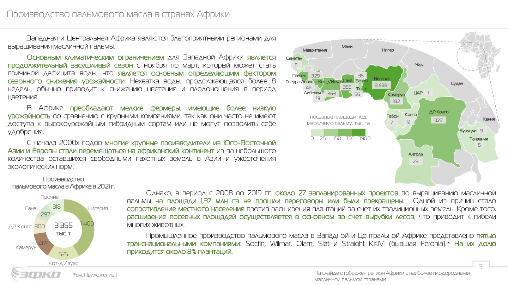
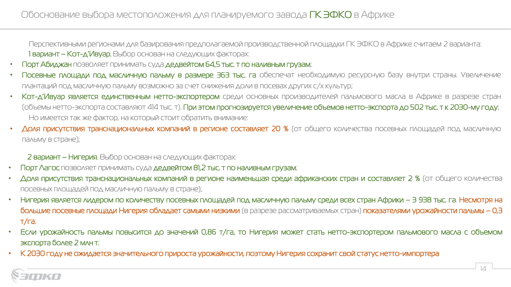

# Пальмовое масло Африки: ресурс, потребление и экспортные возможности

[← Все кейсы](../../README.md) · [Открыть PDF](presentation.pdf) · [Показанный слайд](presentation.pdf#page=3)

**Формат:** Страновой анализ и сценарии до 2030 года

**Дата / период:** 14.02.2023

**Объём:** 21 стр.

*Производство и ресурсная география масличной пальмы, стр. 3.*

## Задача и охват

Оценить ресурсную базу, потребление и экспортные возможности пальмового масла в Африке и сравнить возможные страны размещения производственной площадки.

Подробно рассмотрены **Нигерия, Кот-д’Ивуар, Камерун, ДР Конго и Гана**. Исторические показатели 2017–2021 годов и баланс сезона 2021/22 дополнены сценарными оценками на 2030 год. Сопоставлены площади плантаций, производство, спрос, внешняя торговля, структура землевладения и портовые ограничения.

## Что сделано

- Подготовлены континентальная карта торговли и сводка производства пальмового масла (стр. 2–3).
- Собраны сопоставимые паспорта пяти стран: землепользование, площади культур, население, экономика и портовая инфраструктура (стр. 4–13).
- Построено сравнение текущего производства и потребления с оценками 2030 года; описаны демографические, агротехнологические и земельные предпосылки.
- Выделены доли международных компаний в плантациях и ограничения терминалов по дедвейту судов (стр. 16–21).
- Сформулировано сравнение двух вариантов размещения площадки — Кот-д’Ивуар и Нигерия (стр. 14).

## Выводы и сценарии материала

Континентальная сводка за 2021 год показывает производство около **3 355 тыс. т** при потреблении **8 486 тыс. т**. Основной вывод — зависимость большинства рассматриваемых рынков от импорта, несмотря на наличие площадей и потенциал повышения продуктивности.

| Вариант | Аргументы презентации | Ограничения и сценарий |
|---|---|---|
| Кот-д’Ивуар | Нетто-экспортёр среди пяти выбранных производителей; сырьевая база 363 тыс. га; порт Абиджан | Доля международных компаний в площадях около 20%; на стр. 14 нетто-экспорт 414 тыс. т и прогноз до 502 тыс. т к 2030 году |
| Нигерия | Крупнейшие площади среди пяти стран — 3 938 тыс. га; доля международных компаний около 2%; порт Лагос | В базовом сценарии сохраняется импортозависимость; условное повышение показателя урожайности с 0,3 до 0,86 т/га рассматривается как возможность выхода в нетто-экспорт |

Для Нигерии презентация отделяет базовое ожидание до 2030 года от условного сценария повышения урожайности: экспорт свыше 2 млн т относится ко второму, а не к базовому прогнозу. Камерун, ДР Конго и Гана в изложенных сценариях сохраняют дефицит собственного производства относительно потребления.

Результат — аргументированный список двух направлений для дальнейшей проработки. Финансовая модель инвестиций, окупаемость и факт реализации проекта в PDF отсутствуют.

## Участие и визуальная подача

Ответственные на титуле: **Сторожук К. Р., Курлыкина М. А., Шевченко А. С. и Макарьева Н. О.** Кейс показывает командный страновой анализ с участием владельца портфолио; индивидуальное распределение разделов не указано.

Использованы карты посевных площадей и торговли, единые страновые карточки, диаграммы землепользования, балансовые столбцы и пары «2021 / 2030». Табличные приложения позволяют раскрыть инфраструктурные аргументы, не перегружая основные слайды.

## Маршрут просмотра

| Страницы PDF | Содержание |
|---|---|
| 2–3 | Континентальный рынок и структура производства |
| 4–13 | Пять стран: ресурс, спрос, инфраструктура, прогноз |
| 14 | Сравнение двух вариантов размещения |
| 16 | Компании и площади плантаций |
| 17–21 | Порты и терминалы |

## Ограничения исходного материала

Это исследование февраля 2023 года; сценарии на 2030 год не проверялись на текущих данных. В тексте стр. 7 есть несогласованность: фраза об увеличении производства «с 215 тыс. т» расходится с диаграммой, где база — 575 тыс. т. В README эта текстовая база не используется. Для Кот-д’Ивуара экспорт и нетто-экспорт нельзя смешивать: в сводном балансе фигурируют также импорт и запасы. Дедвейт судна не равен годовой пропускной способности терминала. Показатели урожайности требуют проверки определения продукта: урожай плодов и выход масла — разные величины. Земельные и экологические ограничения включены в текст как факторы риска сценариев, а не как автоматически доступный ресурс.

## Ещё один слайд

*Сопоставление вариантов размещения производственной площадки, стр. 14.*

## Инструменты и состав

**MS Excel** — основной инструмент расчётов; **MS PowerPoint** — подготовка визуальной презентации, по сведениям владельца портфолио. В этом комплекте доступны PDF и превью; рабочие Excel-книги, формулы и редактируемые PowerPoint-файлы не приложены.

## Происхождение материала

Исходный файл: `Анализ рынка пальмового масла Африки_14.02.2023.pdf`. Для портфолио изменены имя файла и служебные метаданные PDF; содержание страниц, фирменное оформление и указанные исполнители сохранены. Все числа и выводы выше относятся к этому историческому материалу.
