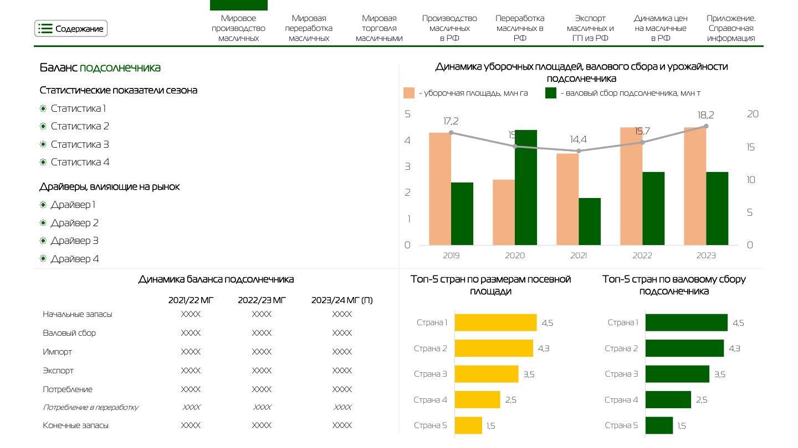
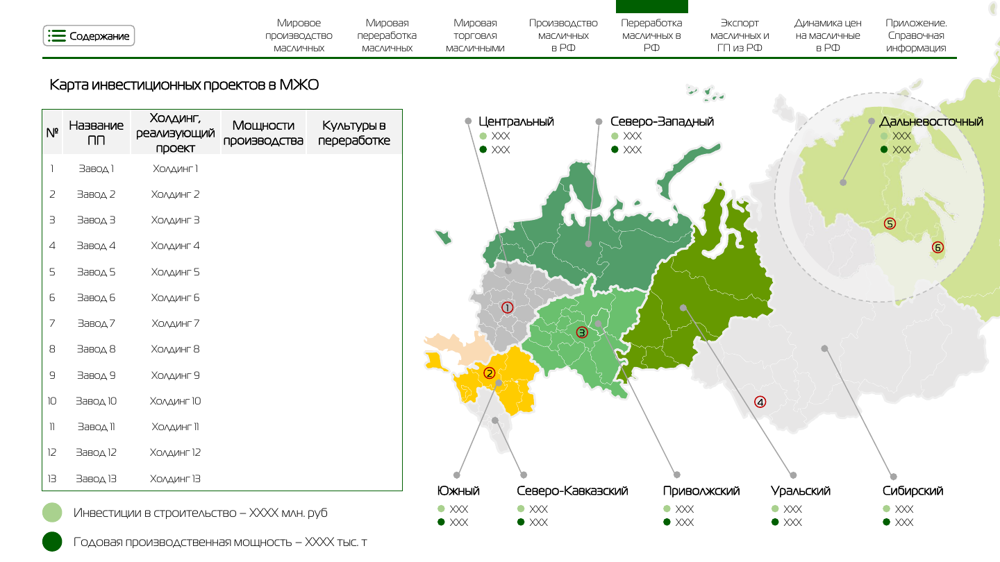

# Макет ежемесячного дайджеста масложирового рынка

[← Все кейсы](../../README.md) · [Открыть PDF](presentation.pdf) · [Показанный слайд](presentation.pdf#page=3)

**Формат:** Макет аналитической отчётности

**Дата / период:** Февраль 2024 — обозначение выпуска на обложке

**Объём:** 33 стр.

*Шаблон страницы баланса культуры: динамика, драйверы и рейтинги, стр. 3.*

## Задача и охват

Спроектировать структуру ежемесячного дайджеста российского и мирового масложирового рынка: задать темы мониторинга, повторяемые типы слайдов и навигацию по большому аналитическому материалу.

Охват: **подсолнечник, рапс, соя и лён**, сырьё, растительные масла и шроты; мировое производство и торговля, российская переработка, экспорт, цены и инвестиционные проекты. На обложке указан выпуск «февраль 2024»; это подпись макета, а не подтверждение выпуска законченного исследования.

## Что сделано

- Разработана структура из восьми тематических блоков с содержанием и повторяемой верхней навигацией.
- Подготовлены шаблоны балансов: запасы, сбор, импорт, экспорт, потребление и переработка.
- Показаны формы сопоставления площадей, урожая и урожайности; рейтингов стран и регионов; структуры мировой торговли.
- Разработаны страницы российской переработки с сопоставлением мощностей и загрузки, выпуска масла и шрота, рейтингов холдингов.
- Предусмотрены инвестиционная карта, экспорт по транспортным узлам и направлениям, региональные цены, себестоимость выращивания и блок регулирования.
- В PDF сохранены внутренние ссылки навигации между разделами.

## Результат: система подачи, а не рыночный прогноз

В документе используются **«Страна 1», «Регион 1», «Холдинг 1», «Новость 1», «Драйвер 1», «ХХХХ» и повторяющиеся демонстрационные числа**. Поэтому по нему нельзя делать выводы о фактических объёмах рынка, долях, доходности или направлениях инвестиций.

Результат работы — готовая архитектура регулярной аналитической презентации: один и тот же исследовательский вопрос получает сопоставимый визуальный формат для каждой культуры. Например, читатель может одинаковым способом перейти от мирового баланса культуры к российской переработке, экспорту и ценам.

## Что демонстрирует кейс

Проектирование структуры управленческого отчёта, выбор показателей и визуальных форм, информационную иерархию, повторное использование слайдов и навигацию. Автоматическое обновление из Excel и снижение трудозатрат в измеримых величинах этим PDF не подтверждаются.

Макет предоставлен владельцем как пример своей работы. В отличие от исследовательских презентаций, на титуле нет списка ответственных. Он представлен как отдельный дизайн-кейс, не как завершённое исследование.

## Маршрут просмотра

| Страницы PDF | Назначение шаблонов |
|---|---|
| 2 | Содержание и архитектура отчёта |
| 3–6 | Мировые балансы культур |
| 7–10 | Мировая переработка и продукты |
| 11–14 | Мировая торговля |
| 15–19 | Российская сырьевая база и балансы |
| 20–24 | Переработка, мощности и инвестиционная карта |
| 25–28 | Экспорт по узлам и направлениям |
| 29–32 | Цены и себестоимость |
| 33 | Регулирование и значимость событий |

## Ограничения

При заполнении макета потребуется проверить единицы измерения, названия культур и легенды: в исходнике остались перенесённые подписи соседних шаблонов. Готовые расчётные книги, связи с источниками и механизм обновления не приложены. Реальные рыночные выводы и сценарии для этого кейса намеренно не формулируются.

## Ещё один слайд

*Шаблон инвестиционной карты отрасли, стр. 24.*

## Инструменты и состав

**MS Excel** — основной инструмент расчётов; **MS PowerPoint** — подготовка визуальной презентации, по сведениям владельца портфолио. В этом комплекте доступны PDF и превью; рабочие Excel-книги, формулы и редактируемые PowerPoint-файлы не приложены.

## Происхождение материала

Исходный файл: `Макет дайджеста МЖО_new version.pdf`. Для портфолио изменены имя файла и служебные метаданные PDF; содержание страниц, фирменное оформление и указанные исполнители сохранены. Все числа и выводы выше относятся к этому историческому материалу.
