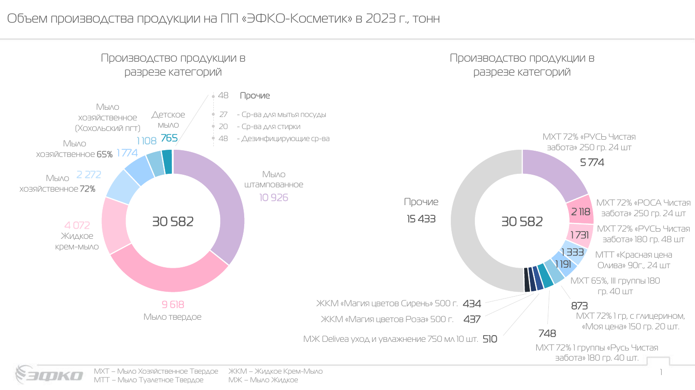

# Структура выпуска мыла и бытовой химии за 2023 год

[← Все кейсы](../../README.md) · [Открыть PDF](presentation.pdf) · [Показанный слайд](presentation.pdf#page=1)

**Формат:** Одностраничная производственная аналитика

**Дата / период:** 2023 - отчётный период; PDF экспортирован 21.02.2024

**Объём:** 1 стр.

*Категорийная и ассортиментная структура выпуска в тоннах, единственная страница PDF.*

## Задача и охват

На одном слайде показать структуру годового выпуска производственной площадки «ЭФКО-Косметик»: основные категории продукции и вклад отдельных ассортиментных позиций.

Это анализ **внутренней структуры производства**, а не оценка всего рынка мыла. Рассмотрены хозяйственное и туалетное мыло, жидкое крем-мыло, детское мыло и небольшие категории бытовой химии. Единицы измерения - тонны, период - 2023 год.

## Что сделано

- Представлен общий объём выпуска **30 582 т**.
- Слева показана группировка по категориям; небольшие категории вынесены в подписи.
- Справа показаны отдельные SKU с характеристиками упаковки и агрегат «Прочие».
- Добавлена расшифровка сокращений МХТ, МТТ, ЖКМ и МЖ.

## Результаты и интерпретация

Среди крупных категорий на слайде выделяются штампованное мыло (**10 926 т**), твёрдое мыло (**9 618 т**) и жидкое крем-мыло (**4 072 т**). В ассортиментной диаграмме крупнейшая отдельно показанная позиция - МХТ 72% «РУСЬ Чистая забота», 250 г, 24 шт. (**5 774 т**).

Агрегат «Прочие» на ассортиментной диаграмме составляет **15 433 т** - примерно **50,5%** от общего выпуска (15 433 / 30 582; доля рассчитана для этого описания). Слайд позволяет быстро увидеть ведущие позиции, но не раскрывает весь ассортимент внутри этой половины объёма.

Полной оценки концентрации всех SKU, динамики относительно прошлого года, продаж, прибыли и рыночной доли здесь нет. Рекомендации об изменении ассортимента и экономический эффект на основании одного слайда не заявляются.

## Вклад и визуальная подача

Материал предоставлен владельцем портфолио как пример своей работы. На самом слайде исполнитель не указан. Две кольцевые диаграммы дают два уровня группировки одного объёма: категории и выбранные ассортиментные позиции. Число в центре фиксирует общую базу сравнения; внешние подписи раскрывают небольшие сегменты.

**Инструменты:** MS Excel - расчёты и группировки; MS PowerPoint - компоновка и оформление, по сведениям владельца. Расчётная книга в комплект не входит.

## Ограничения исходного материала

В суммах округлённых подписей небольших сегментов есть расхождения с центральным итогом. Над правой диаграммой повторён заголовок «в разрезе категорий», хотя подписи содержат SKU; в описании этот уровень назван ассортиментным. Классификация категорий воспроизведена по слайду, справочник номенклатуры отсутствует. Отчётный 2023 год не следует путать с датой экспорта PDF в феврале 2024 года.

## Происхождение материала

Исходный файл: `Производство мыла в 2023 г.pdf`. Для портфолио изменены имя файла и служебные метаданные PDF; содержание страниц, фирменное оформление и указанные исполнители сохранены. Все числа и выводы выше относятся к этому историческому материалу.
